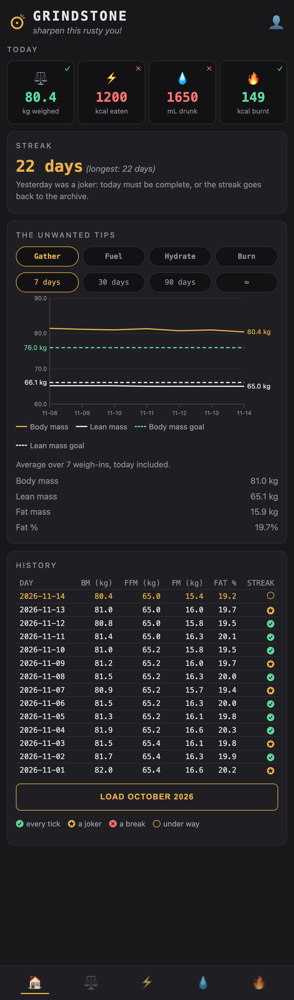
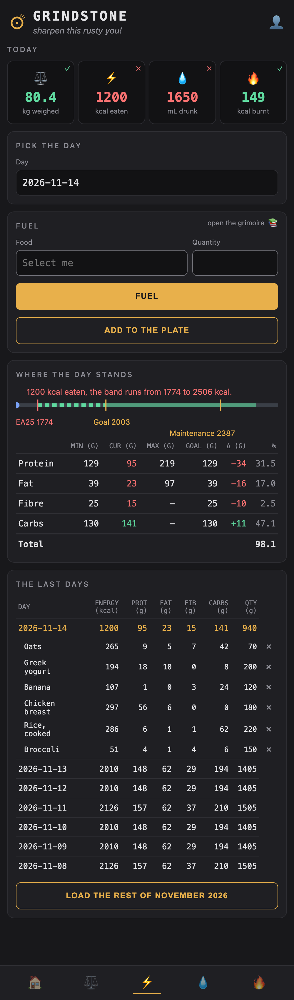
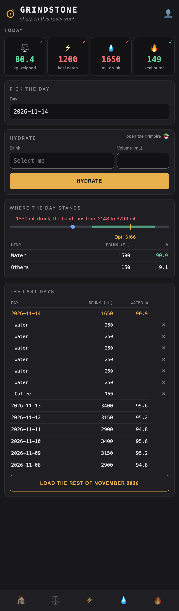
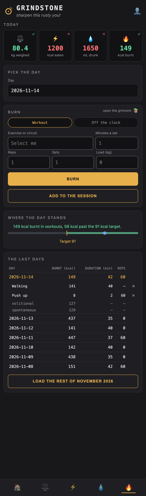
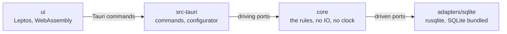

# Grindstone

*"Sharpen this rusty you!"*

A personal tracker for body mass, food, drinks and training, on an Android phone and offline. Rust from the screen to the storage: Tauri 2, Leptos compiled to WebAssembly, SQLite, and a hexagonal core held by strict gates.

  
  
  
  

The screenshots show fictional records.

## Health notice

- Grindstone is not a medical device and gives no medical advice. Its recommendations are made for an average healthy adult, from published sources, as a place to start rather than a prescription. Check them, adjust them, and ask a doctor when in doubt.
- Do not use it if you are under 18, pregnant or breastfeeding, have or had an eating disorder, or live with kidney disease or any condition that changes what you should eat or drink, without your doctor's advice.
- Content note: it counts calories, weighs and tracks every day. If that feeds worry rather than curiosity, stop, and talk to someone you trust.

## What it does

- 🏠 **Home:** today's four ticks, the streak, the unwanted tips over 7, 30 or 90 days or everything, and the history.
- ⚖️ **Gather:** weigh-ins and waist, the lean and fat masses they give, and the pace towards your goals within a safe lane.
- ⚡ **Fuel:** foods, meals and plates from your own catalog, an energy band from a floor to a cap, and the four macros.
- 💧 **Hydrate:** drinks against a water band drawn from your lean mass.
- 🔥 **Burn:** workouts and circuits priced in kcal, and the day off the clock.
- 👤 **Profile:** your body, goals and targets, each with a sourced recommendation, and a copy of every record to keep on the Mac.

Every figure, and the source behind it, is in [docs/FEATURES.md](docs/FEATURES.md).

## How it is built

| Part | Technology | Role |
| --- | --- | --- |
| `ui` | Leptos 0.8, client-side, compiled to WebAssembly by Trunk | the screen |
| `src-tauri` | Tauri 2 | the app shell on Android, and on the Mac under `make dev`: its commands and the configurator that wires everything at start |
| `core` | plain Rust | the application: its rules, what it offers (driving ports) and what it needs (driven ports) |
| `adapters/sqlite` | rusqlite, SQLite bundled | the storage, behind the core's storage ports |

Each command hands over to one of the core's driving ports: `for_tracking`, `for_fuelling`, `for_hydrating`, `for_burning`, `for_cataloguing`, `for_setting_up_the_profile`, `for_reviewing_progress`, `for_charting`, `for_keeping_a_copy`, `for_starting_over`.

Nothing lands unless the gates pass:

- `make check`: formatting, Clippy on native and WebAssembly with warnings as errors, every test, no uncovered line outside the wiring, and the dependencies' licences;
- `make test-ui`: the screen in a headless Chrome, every command answered by a stub read back through the core's own types;
- `make mutants`: mutation testing of the core, so the tests are shown to bite.

## Get it

There is no release to download yet: build it from source.

- [GETTING_STARTED.md](GETTING_STARTED.md): run and test it on a Mac or on Linux.
- [RUNBOOK.md](RUNBOOK.md): from nothing to the app installed on an Android phone.

## Why

- The tracker must work where training happens: outdoors, on the phone, with or without a network.
- The records belong on the device: SQLite, no account, no server.
- Two earlier attempts taught what to avoid: a Sycamore draft kept its records in the browser's storage, and a SvelteKit spike grew too large before reaching the phone.
- So this one put a usable app on the phone first, then grew one real need at a time.

## Licence

The code is under the MIT licence, and the creative content (texts, lore, artwork) under CC BY-NC-SA 4.0: see [LICENSE](LICENSE). The notices of the dependencies the APK carries are in [THIRD_PARTY_LICENSES.md](THIRD_PARTY_LICENSES.md).

## Documents

| Document | Use it to |
| --- | --- |
| [docs/FEATURES.md](docs/FEATURES.md) | read every screen and every figure, with its source |
| [GETTING_STARTED.md](GETTING_STARTED.md) | run and test the app locally |
| [RUNBOOK.md](RUNBOOK.md) | go from nothing to the app installed on the phone, toolchain and USB connection included, and update it |
